# PactPay

**Let your AI agent shop. Keep the final say.**

PactPay is a safety layer between an AI shopping agent and your money. You approve a short list of rules once. The agent finds real offers and PayPal holds your payment. Right before any money moves, a fixed gate (not an AI model) re-checks the live offer against your rules. If the seller changed anything, the hold is voided and nothing is captured.

> **Try it:** [ADD HOSTED URL] · **Demo video:** [ADD YOUTUBE LINK] · **Test account:** `judge` / `PactPay-Judge-2026` (PayPal Sandbox money only)


## The problem

AI agents can already browse and check out. What they can't do reliably is notice that the deal changed between "you said yes" and "the money moved": a price edit, an item that sold out, a substituted product, or a line of text in a listing that tells the agent to ignore its limits.

People don't trust agents with their money yet. Two surveys of shoppers point the same way:
- In a [Riskified Q1 2026 survey](https://ir.riskified.com/node/8896/pdf), about half of respondents said the AI platform, not the retailer, should be responsible for unauthorized agent purchases.
- In [Accenture's 2026 consumer research](https://www.accenture.com/gb-en/insights/consulting/talk-my-ai-agent), few shoppers were open to fully autonomous purchasing, including payment.

These are self-reported surveys, not observed behavior. They describe the trust gap; they don't prove demand for PactPay.

Today an AI platform has two choices: make the user confirm every purchase (which defeats the point of an agent) or accept the risk. Fraud checks don't help, because a legitimate merchant whose offer drifted isn't fraud. It just isn't what the user approved.

## The solution

PactPay adds the missing step between authorizing a payment and capturing it.

1. **You set the rules once.** Describe a purchase in plain words. AI turns it into editable rules (budget, must-haves, preferences). You approve them. They are stored and hashed on the server and locked.
2. **You choose how much the agent does alone.** Ask me every time, ask me above a limit, or handle it within my rules.
3. **The agent shops.** It searches a live catalog, ranks offers against your rules, and shows the **final total with shipping and tax up front**, so the number you see is the number PayPal holds.
4. **PayPal holds the money.** Nothing is captured. A person approves each hold.
5. **A fixed gate decides.** It re-fetches the live offer and the live PayPal authorization and checks everything. All pass: capture once. Anything fails or is unknown: void the hold and capture nothing.
6. **You get proof.** A plain-English result, an attempts table, a PASS / FAIL / UNKNOWN decision receipt, a live PayPal confirmation, and a hash-chained audit trail.

> The AI can recommend. It can't release your money.

## How it works

```mermaid
sequenceDiagram
    autonumber
    actor U as Shopper
    participant P as PactPay
    participant A as AI agent
    participant C as Channel3 (live catalog)
    participant PP as PayPal Sandbox
    U->>P: Describe purchase, review rules, set autonomy, approve
    P->>P: Store and hash the approved rules (locked)
    A->>P: Shortlist (agent key or built-in agent)
    P->>C: Search live offers
    P-->>A: Ranked offers with final totals
    A->>P: Ask for a hold on the best PASS offer
    P->>PP: Create order (authorize, do not capture)
    U->>PP: Approve the hold
    A->>P: Request settlement
    P->>C: Re-check the live offer now
    P->>PP: Re-fetch the authorization
    alt every rule still passes on fresh evidence
        P->>PP: Capture once
    else anything changed, is stale or is unknown
        P->>PP: Void. Nothing captured
        P-->>A: Choose a genuinely different offer, or stop
    end
    P-->>U: Plain-English result, receipt, audit trail
```



## Who it's for

| User | What they get |
|---|---|
| **Shoppers who use AI agents** | Delegate buying without watching every step, with a hard limit the agent can't cross. |
| **AI assistant and agent platforms** | A way to let agents transact and *prove* they stayed within the user's rules. Connect over MCP or HTTP with a limited key. |
| **Marketplaces and procurement tools** | A control point between agent-initiated orders and payment capture, with an audit trail. |
| **PayPal developers** | A worked example of authorize-then-capture with deterministic policy, built on Orders and Payments. |

## Why it matters, and the market

Analysts expect agent-driven purchases to become a meaningful share of online retail. [Morgan Stanley](https://morganstanley.com/insights/articles/agentic-commerce-market-impact-outlook) and [Bain](https://www.bain.com/insights/2030-forecast-how-agentic-ai-will-reshape-us-retail-snap-chart/) both publish 2030 forecasts in the hundreds of billions of dollars of US e-commerce; the figures differ because they define "agentic" differently. We don't claim a market size for PactPay itself. The point is that every dollar that flows through an agent needs a trustworthy check at the moment of payment.

**Business model (a hypothesis, not a result):** a per-protected-transaction fee plus a platform fee for AI platforms and marketplaces that embed the gate, with premium audit, policy management and analytics. The defensible parts are the settlement gate, the policy compiler, the evidence model and the integrations, not the dashboard.

## Competitive landscape and novelty

Several efforts make agent payments safer. They mostly answer *who may pay* and *how credentials are protected*. PactPay answers a different question: *is this payment still what the user approved?*

| Effort | What it covers | How PactPay relates |
|---|---|---|
| [Google's Agent Payments Protocol (AP2)](https://www.vellum.ai/blog/googles-ap2-a-new-protocol-for-ai-agent-payments) and its signed Intent and Cart mandates | Proving what the user authorized; announced with 60+ partners including PayPal | Complementary. AP2 proves authorization; PactPay checks the offer *after* authorization and *before* capture. |
| Card-network programs (Visa Intelligent Commerce, Mastercard Agent Pay) | Agent identity and tokenized credentials | Complementary. PactPay doesn't do identity or tokenization. |
| OpenAI and Stripe's Agentic Commerce Protocol | A standard way for agents to check out with merchants | Complementary. It standardizes checkout; PactPay guards capture. |
| PayPal's Agent Toolkit and MCP server | Tools for agents to call PayPal APIs | PactPay is the policy layer that decides whether those calls (such as capture) should happen. |
| Fraud and risk engines | Detecting anomalous or fraudulent payments | Different problem. A legitimate offer that drifted isn't fraud. |

**What is novel here** (the combination, not a single trick): typed rules the user approves once; server-enforced autonomy so an agent holding a key can't act above the user's limit; a gate that makes the capture decision from fixed rules on fresh, attributable evidence, treating *unknown* as *not allowed*; recovery that forces the agent to a genuinely different offer after a failure; and seller text treated as untrusted data with a live injection test.

## What you can do in the app

- **Shopper flow:** describe, edit rules, choose autonomy, shortlist with final totals, hold, result.
- **Autopilot:** the agent picks, holds and settles by itself, with visible countdowns and Cancel and Pause at every step. After a block it skips that offer and finds the next one.
- **Bring your own agent:** create a limited agent key, then use MCP (`scripts/mcp-server.mjs`) or HTTP. `pnpm agent:redteam` shows a misbehaving agent being refused. `scripts/llm-agent.mjs` runs a real LLM agent through the gateway.
- **Seller-text reader (second use of AI):** reads a listing, returns only facts it can quote word for word, labels them *seller-stated, not verified*, and includes a live prompt-injection test.
- **Activity (AG Grid):** every attempt with offer, outcome, captured amount, failed rules, evidence state, injected change, autonomy, quick filters, and expandable event lineage.
- **Accounts:** username and password sign-up and sign-in; your rules, keys and activity are private to your account.

## Try it

**Hosted:** open [ADD HOSTED URL], sign in as `judge` / `PactPay-Judge-2026` (or create your own account), and follow [`docs/JUDGES.md`](docs/JUDGES.md). The demo account is shared, so its Activity may show other reviewers' attempts. Create your own account for a private view. PayPal Sandbox asks for a buyer test login; it's in the Devpost testing instructions.

**Locally:** you need Node 20+, pnpm 10 and Docker.

```bash
pnpm install
cp .env.example apps/web/.env.local     # fill in your keys (Windows: copy .env.example apps\web\.env.local)
pnpm db:up
pnpm dev                                 # http://localhost:3000
```

Local runs allow guest use. Set `PACTPAY_REQUIRE_LOGIN=1` to require an account (hosted deployments do), and set `PACTPAY_DEMO_USERNAME` and `PACTPAY_DEMO_PASSWORD` to create a shared demo account. Keys you need: a PayPal Sandbox app and buyer test account, a Channel3 key, and optionally a Groq key. Without Groq the app falls back to a basic parser and says so on screen.

Verify a clean install:

```bash
pnpm --filter @pactpay/pact-core typecheck
pnpm --filter @pactpay/pact-core test      # 138+ tests
pnpm --filter web typecheck
pnpm --filter web build
```

## Architecture

The diagram above is [`docs/architecture.svg`](docs/architecture.svg). In short:

```
apps/web              Next.js app: shopper flow, order screen, Activity (AG Grid), auth, API routes
packages/pact-core    Pure TypeScript: policy engine, settlement gate, autonomy, audit chain,
                      untrusted-text guard, seller simulation, agent keys, passwords (138+ tests)
lib                   Server modules: PostgreSQL, PayPal, accounts, approvals, agent keys, seller world
scripts               MCP server, red-team, LLM agent, drift collector and report
docs                  Judge guide, storyboard, Devpost text, limitations, threat model, ADRs
```

Design rules worth knowing: the model never has settlement authority (ADR-002); authorize before capture (ADR-001); a transaction is reachable only by the account that approved its rules; the app only ever talks to the PayPal Sandbox.

## Security model

- Rules are stored server-side, hashed, locked, and bound to your account. Orders accept an approval id, never browser-supplied rules.
- Every transaction route checks that the transaction belongs to the caller's account. A leaked transaction id gives no access.
- The settlement route re-fetches the live PayPal authorization, uses an idempotent claim, and routes uncertain outcomes (timeouts, ambiguous responses) to review instead of retrying blindly.
- Agent keys are bound to one approval, expire in 24 hours, can be revoked, and are stored as hashes. The gateway always acts as the agent, never as the user.
- Passwords are hashed with scrypt. Login sessions are opaque tokens stored as hashes. Auth and costly routes are rate limited.
- Every PayPal call refuses to run unless the configured host is the PayPal Sandbox.
- The audit trail is hash-chained, so ordinary edits are detectable.

## Limitations and constraints

Please read these before judging. Full list in [`docs/LIMITATIONS.md`](docs/LIMITATIONS.md).

- **Sandbox only.** PayPal Sandbox test money. No retailer order is ever placed, and PactPay is not integrated with any retailer's checkout.
- **Shipping and tax are fixed test values** (a flat $4.99 and 8%). The seller changing the deal is **simulated** with a labelled Demo control, because a sandbox can't pay a real store and real stores won't change on cue. Catalog data and PayPal calls are real, and so is the re-check against the live catalog.
- **Catalog drift, not checkout drift.** Our drift tooling measures what the catalog reports, not what a retailer's checkout charges.
- **A person still approves each hold on PayPal.** PactPay doesn't skip that step.
- **Basic accounts.** Username and password only: no email verification, password reset or multi-factor sign-in. The agent key stands in for the agent's own identity; a production system would authenticate agents separately.
- **USD only**, a single catalog provider, and AI output that can be wrong (the user reviews the rules; a labelled fallback parser exists).
- **Not a regulated financial product.** No KYC, PCI or compliance claims.
- **Free hosting limits.** Free Render plans sleep and the free database expires after 30 days.

## Roadmap

Real checkout-page evidence (a browser extension or merchant APIs), authenticated agent identities, merchant integrations, saved payment methods so holds need no tap, and a measured drift study. See [`docs/REAL-DATA.md`](docs/REAL-DATA.md).

## Docs

[Judge guide](docs/JUDGES.md) · [Agent integration](docs/AGENT-INTEGRATION.md) · [Limitations](docs/LIMITATIONS.md) · [Sponsor tools](docs/SPONSOR-TOOLS.md) · [Deploy on Render](docs/DEPLOY-RENDER.md) · [Real data](docs/REAL-DATA.md) · [Threat model](docs/THREAT_MODEL.md) · [Video storyboard](docs/VIDEO-STORYBOARD.md) · [Devpost text](docs/DEVPOST-SUBMISSION.md)

## License

MIT. See [`LICENSE`](LICENSE). Built for the PayPal AI Hackathon.
