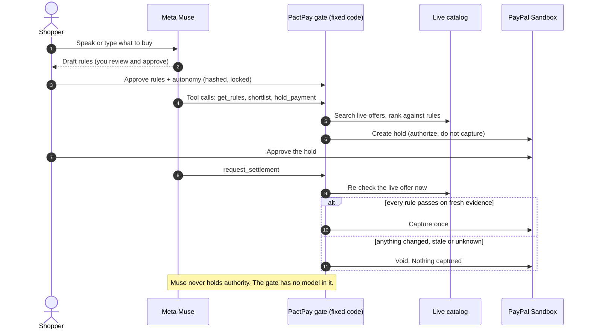

# PactPay × Meta Muse

**An AI agent that shops for you, reads the real checkout page, and can't be talked into overspending.**

Meta's Muse models do the seeing, hearing, reading and deciding-what-to-try. A small piece of fixed code, not a model, decides whether any money moves. That split is the whole product.

> **Live app:** [ADD HOSTED URL] · **3-minute demo:** [ADD VIDEO LINK] · **Judge login:** `judge` / `PactPay-Judge-2026` (PayPal Sandbox test money only)
> **Track:** Indie Developer · **Theme:** Build for Your World


## The problem

AI agents can already browse and check out. What they can't do reliably is notice that the deal changed between "you said yes" and "the money moved": a price edit, a surprise fee, a swapped item, or one line of small print telling the agent to ignore its limits. Today you either approve every purchase yourself (which defeats the point of an agent) or you accept the risk.

## The idea

> **Muse can see, hear, read and act. It can't release your money.**

| Muse does (probabilistic) | Fixed code does (deterministic) |
|---|---|
| Hears your request | Locks the rules you approved |
| Writes the rules for you to review | Compares every number to those rules |
| Chooses which tools to call | Checks the itemized charges add up |
| Reads a checkout screenshot, twice | Scans page text for instructions aimed at an AI |
| Explains the outcome | Re-checks the live offer and decides capture or void |

If the model is fooled, confused or wrong, the worst case is that it asks for something the gate then refuses.

## Built on Meta

Every AI feature in this app runs on a Meta model. Nothing else is called.

| Meta model | Where it's used | Call |
|---|---|---|
| **Muse Spark 1.3** (Meta Model API) | Writes your rules (strict structured output), runs the tool-calling shopping agent, reads checkout screenshots (vision), reads seller listings, explains outcomes | `POST /v1/chat/completions` with `tools`, `response_format: json_schema`, `image_url` |
| **Muse Spark Open** (open weights, via Baseten) | The same features on open weights, and the **second independent reader** in the Checkout Inspector | OpenAI-compatible chat completions |
| **Muse Voice Transcribe 1.0** | "Say it instead": speak your purchase, get the text | `POST /v1/asr/transcribe` (WAV, PUSH_TO_TALK) |

How it goes beyond a basic integration:

- **A real agent loop**, not a prompt wrapper. Muse picks tools, we answer every call, bound the loop, cap tool output, and stop when a human must act. Tested without a network ([`agent-loop.test.ts`](packages/pact-core/test/agent-loop.test.ts)).
- **Multimodal verification.** Muse Spark reads a checkout screenshot; fixed code does the arithmetic and the policy.
- **Cross-model agreement.** With both keys set, *two different Meta models* read the page independently. If they disagree, nothing is called safe.
- **Open weights in the safety path**, not a side demo.
- **Honest protocol use:** `max_completion_tokens`, `reasoning_effort`, `json_schema` output, `tool_choice: "auto"`, and full tool-call replay, all as Meta's docs specify. See [`docs/META-INTEGRATION.md`](docs/META-INTEGRATION.md).

## What you can do

1. **Say it.** Hold the mic and describe a purchase. Muse Voice Transcribe turns it into text.
2. **Rules from plain words.** Muse Spark drafts editable rules (budget, must-haves, preferences). You approve; they're hashed and locked server-side. The badge says exactly which model wrote them.
3. **Muse Agent** (`/muse-agent`). Give it a job and watch it call tools live: read rules, search real stores, rank offers, ask for a PayPal hold. Click **Try to tempt it** and watch PactPay refuse. A person approves the hold; the gate settles.
4. **Checkout Inspector** (`/inspector`). Upload any checkout screenshot. Muse reads it twice; the gate returns **Safe to pay / Do not pay / Can't verify** with a rule-by-rule receipt. Five built-in pages (honest, hidden fee, hidden instructions, over budget, not a checkout) and a one-click **suite** that proves every verdict.
5. **Seller-text reader.** Muse extracts only facts it can quote word for word, labeled *seller-stated, not verified*, with a live prompt-injection test.
6. **Settlement gate.** Right before capture, the live offer and live PayPal authorization are re-fetched and every rule re-checked. Any fail or unknown: void, capture nothing.
7. **Activity + proof.** Decision receipts (PASS / FAIL / UNKNOWN), a hash-chained audit trail, and an AG Grid activity log.
8. **Bring your own agent.** A limited, expiring agent key plus an MCP server and HTTP gateway. `pnpm agent:muse` runs a Muse agent from the terminal.

## How it works



## Why it can't be tricked

- **No authority for the model.** Its only tools are the gateway; there is no tool to edit rules, raise a limit or release money (ADR-002).
- **Untrusted input stays data.** Seller text and screenshot text are scanned and labeled hostile; model output is parsed, bounded and validated before use.
- **Unknown is never safe.** Unreadable page, missing field, or two readings that disagree all end in *Can't verify*.
- **Autonomy is server-enforced.** The agent key is bound to one approval, expires in 24 hours, is stored as a hash, and always acts as the agent.
- **Authorize, then capture** (ADR-001). Uncertain outcomes go to review, never a blind retry.

## Try it in two minutes

No PayPal setup needed for the Meta features: open **Checkout check**, pick *A page that talks to the agent*, press **Inspect**, then **Run the suite**. Full path in [`docs/JUDGES.md`](docs/JUDGES.md).

## Run it locally

Needs Node 20+ (22 recommended), pnpm 10, Docker.

```bash
pnpm install
cp .env.example apps/web/.env.local     # Windows: copy .env.example apps\web\.env.local
# put MODEL_API_KEY (Meta Model API) in apps/web/.env.local; add BASETEN_API_KEY for open weights
pnpm db:up
pnpm dev                                 # http://localhost:3000
```

The Inspector (demo rules) and voice input need only `MODEL_API_KEY`. The full shop-and-settle flow also needs PayPal Sandbox and Channel3 keys. Without a Meta key the app falls back to a basic rule parser and says so on screen.

Verify:

```bash
pnpm --filter @pactpay/pact-core typecheck
pnpm --filter @pactpay/pact-core test        # 170+ tests, no network
pnpm --filter web typecheck
pnpm --filter web build
```

## Repository layout

```
apps/web              Next.js app: shop flow, Muse Agent, Checkout Inspector, Activity, API routes
packages/pact-core    Pure TypeScript: policy engine, settlement gate, checkout inspection, agent loop,
                      untrusted-text guard, audit chain, autonomy (170+ tests)
lib                   Server modules: Meta model gateway (llm-provider.ts), PostgreSQL, PayPal, accounts
scripts               MCP server, Muse CLI agent, red-team, drift tools
docs                  Judge guide, Meta integration, demo script, limitations, threat model, ADRs
```

## The Meta layer:

- `lib/llm-provider.ts`: Meta model gateway (Meta Model API + Muse Spark Open)
- `packages/pact-core/src/checkout-inspection.ts`, `inspection-samples.ts`, `agent-loop.ts`, `wav.ts`, `ai-labels.ts`
- `apps/web/app/inspector`, `apps/web/app/muse-agent`, `apps/web/app/api/{inspector,muse-agent,voice,ai}`, `components/VoiceButton.tsx`
- Rewiring of rule drafting, seller-text reading and outcome explanation onto Muse; the budget-cap fix (`quoteRulesFor`); `scripts/llm-agent.mjs`

PactPay's policy engine, settlement gate, PayPal Sandbox flow and activity tooling are an existing project by the same author, which this submission builds on. They are described here so judges can see what the Meta layer sits on top of.

## Limitations

Read [`docs/LIMITATIONS.md`](docs/LIMITATIONS.md). Key points:

- **Sandbox only.** PayPal Sandbox test money; no retailer order is ever placed. Shipping and tax are fixed test values, and the seller changing the deal is a labeled simulation.
- **The Inspector can't catch a model that misreads in the same way twice.** Two readings, cross-model agreement and arithmetic make that unlikely, not impossible. It is a guard, not a guarantee.
- **A person still approves each hold on PayPal.**
- Basic accounts, USD only, one catalog provider, AI output that can be wrong (you review the rules).

## Docs

[Judge guide](docs/JUDGES.md) · [Meta integration](docs/META-INTEGRATION.md) · [Demo video script](docs/DEMO-VIDEO.md) · [Submission copy](docs/SUBMISSION.md) · [Limitations](docs/LIMITATIONS.md) · [Threat model](docs/THREAT_MODEL.md) · [Deploy on Render](docs/DEPLOY-RENDER.md)

## License

MIT. See [`LICENSE`](LICENSE). Built for the Meta Global AI Developer Hackathon 2026.
