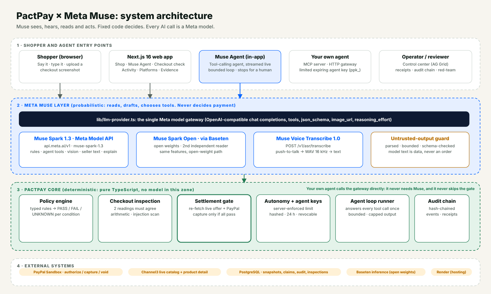

# PactPay Architecture



| Diagram | What it shows |
|---|---|
| [00 One workflow](diagrams/00-one-workflow.png) | The single Shop page workflow and who acts at each step |
| [01 System architecture](diagrams/01-system-architecture.png) | Entry points, Meta Muse layer, deterministic core, external systems |
| [02 Trust boundary](diagrams/02-trust-boundary.png) | What Muse does vs what fixed code does; no model has authority |
| [03 Hold, inspect, settle](diagrams/03-hold-inspect-settle.png) | Order lifecycle, gate facts, how the inspection verdict affects settlement |
| [04 Agent keys and marketplace](diagrams/04-agent-key-marketplace.png) | Agent key, gateway tools, what the server refuses |
| [05 Discovery and evidence](diagrams/05-discovery-evidence.png) | Snapshots, evidence review, seller-text reader, receipts |
| [06 Checkout Inspector](diagrams/06-checkout-inspector.png) | Two readers, fixed rules, three verdicts, fail-closed table |

SVG sources sit next to each PNG. The diagrams are generated by a small script and can be edited as plain SVG.


## Logical flow

```text
User Intent
   |
   v
Intent Compiler (LLM)
   |
   v
Structured Purchase Pact
   |
   +----------------------+
   |                      |
   v                      v
Shopping Agent       Policy Engine
   |                      |
   +----------+-----------+
              v
       Offer Selection
              |
              v
       PayPal Order
        intent=AUTHORIZE
              |
              v
       PayPal Authorization
              |
             HOLD
              |
              v
      Evidence Collector
              |
              v
       Semantic Verifier
              |
              v
      Deterministic Gate
          /        \
       BLOCK       PASS
         |           |
       VOID       CAPTURE
         \           /
          v         v
          Audit Event Ledger
                |
                v
         AG Grid Control Center
```

## Trust boundaries

### Trusted
- PactPay server
- deterministic policy engine
- PayPal API responses after TLS/authentication
- verified PayPal webhooks

### Untrusted
- LLM output before schema validation
- product descriptions
- merchant messages
- external webpages
- user-provided evidence
- browser/client input

## Settlement state machine

`DRAFT -> OFFER_SELECTED -> ORDER_CREATED -> AUTHORIZED -> VERIFYING -> BLOCKED | CAPTURE_ELIGIBLE -> CAPTURED -> COMPLETED`

Failure states are explicit and terminal where appropriate. Any retry must be idempotent.

## Checkout inspection and the gate

Once the hold is confirmed, the order page calls `GET /api/shop/checkout-page`, which draws the checkout page from the order's stored sandbox terms (`pact-core/src/checkout-page.ts`), rasterizes it in the browser and posts it to `POST /api/inspector/checkout` with the order id. The Inspector's verdict (`SAFE_TO_PAY`, `DO_NOT_PAY`, `CANNOT_VERIFY`) is stored per transaction in `pactpay_checkout_inspections`. At settlement the route reads the latest one and passes `checkoutInspection: none | safe | blocked | unverified` into `evaluateSettlementGate`, which adds `CHECKOUT_INSPECTION_BLOCKED` or `CHECKOUT_INSPECTION_UNVERIFIED` as blocking reasons. A failed lookup is treated as `unverified` (fail closed). `none` changes nothing.
